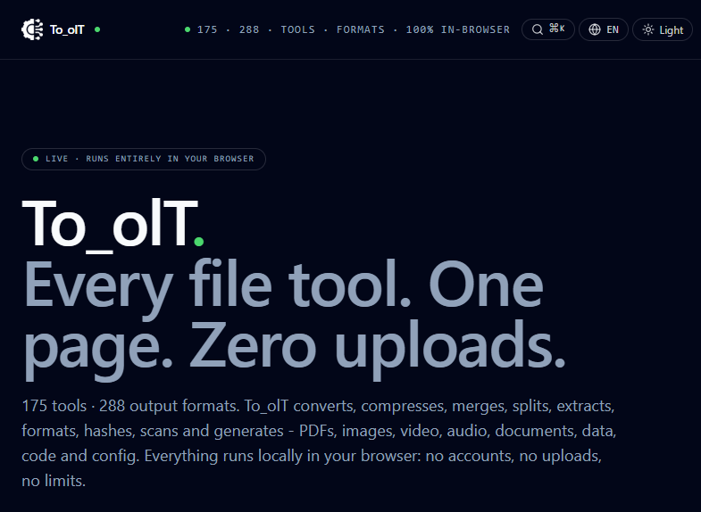

<div align="center">

# To_olT

**Every file tool. One page. Zero uploads.**

175 tools for PDFs, images, video, audio, documents, data, code and design, all running inside your browser.

<p>
  <a href="https://toolt.sdxrnx.workers.dev"></a>
  <a href="https://github.com/SaddexRnx/toolt/issues/new/choose"></a>
  
  
  
  
</p>

<p>
  
  
  
  
  
</p>

[Live demo](https://toolt.sdxrnx.workers.dev) · [GitHub](https://github.com/SaddexRnx/toolt) · [All tools](#what-is-inside) · [How it works](#how-it-works) · [Run it locally](#run-it-locally) · [Report a bug](#something-broken)

</div>

---

I built To_olT because uploading a file just to merge two PDFs never made sense to me.

The browser is a capable computer now. WebAssembly handles video, OCR and PDF work at a speed that needed a server a few years ago, and the File API can read and write files without a round trip. So I put the whole toolbox on one page and removed the server from the path.

Drop a PDF, a 4K video, a spreadsheet, a token or a folder of images. Every byte is processed on your device and handed straight back. There is no upload endpoint, no storage bucket and no account. When you close the tab, the working copy is gone.

<p align="center">
  
</p>

<br />

|  Tools  | File converters | Interactive tools | Languages | Uploads | Accounts | Trackers |
| :-----: | :-------------: | :---------------: | :-------: | :-----: | :------: | :------: |
| **175** |     **135**     |      **40**       |  **21**   |  **0**  |  **0**   |  **0**   |

## About

I built To_olT because I was tired of uploading files to sites I didn't trust to delete them. Every tool here runs in the browser, which means there's no server to maintain and nothing of yours to leak. I'm Saddek, a developer in Algeria. You can find more of my work at [saddexrnx.github.io](https://saddexrnx.github.io) or reach me on [Telegram](https://t.me/Saddex_x).

## What you get

The catalog is split into three groups:

- **135 converters** for PDF, images, video, audio, documents, spreadsheets, data, archives and code.
- **Everyday utilities** for hashing, encoding, formatting, validating, generating QR codes and inspecting files.
- **40 calculators and builders** for health, math, finance and CSS. They update as you type.

A few parts tie it together:

- **Smart Drop** looks at the extension and shows every tool that can open it.
- **Batch mode** queues many files, previews the results, retries failures, renames outputs and exports a ZIP.
- **History** keeps metadata in `localStorage` and result blobs in IndexedDB, so you can download or re-run an old job.
- **The command palette** searches all 175 tools with `Cmd+K` or `Ctrl+K`.
- **21 interface languages**, including Arabic and Hebrew with RTL layout.
- **Light and dark themes** that are applied before React hydrates, so the page does not flash.

## Why it runs in the browser

Privacy gets the headline, but it is not the only reason.

A server-based converter can promise to delete your file, but you only have its word for it. To_olT never receives the file, so there is nothing to delete and nothing to leak. That is a simpler guarantee.

Local work also starts immediately. There is no upload bar, no queue position and no cold container. The heavy engines (FFmpeg, Tesseract, the background removal model) download once on first use and stay in the browser cache after that.

And one page beats twelve tabs. A typical PDF task touches three sites: one to merge, one to compress, one to convert. Here the tools share one search box, one batch queue, one history and one design.

## How it compares

I put the main alternatives side by side. This is about the processing model and the free-tier experience, not every paid plan. Limits and policies change, so check the provider if it matters to you.

|                             |        **To_olT**        |   **iLovePDF**    |   **Smallpdf**    |  **TinyWow**  |  **Convertio**  | **Adobe Acrobat online** |
| --------------------------- | :----------------------: | :---------------: | :---------------: | :-----------: | :-------------: | :----------------------: |
| Where files are processed   |    **On your device**    |   Their servers   |   Their servers   | Their servers |  Their servers  |      Their servers       |
| Your file is uploaded       |        **Never**         |        Yes        |        Yes        |      Yes      |       Yes       |           Yes            |
| Account required            |          **No**          |  No, but limited  |  No, but limited  |      No       | No, but limited |    Yes for most tools    |
| Free-tier task limits       |         **None**         | Daily / task caps | Daily / task caps |    Varies     |   Daily caps    |          Varies          |
| Watermarks on free output   |         **None**         |    Some tools     |    Some tools     |  Some tools   |   Some tools    |        Some tools        |
| Works offline               |         **Yes**          |        No         |        No         |      No       |       No        |            No            |
| Ads or third-party trackers |         **None**         |     Free tier     |     Free tier     |      Ads      |       Ads       |       Account wall       |
| Source code available       |         **MIT**          |        No         |        No         |      No       |       No        |            No            |
| Coverage                    | **175 tools in one app** |    PDF-focused    |    PDF-focused    |     Broad     | Format-focused  |     Document-focused     |

<sub>This compares the processing model and typical free-tier experience of each service, not every paid plan. Limits and policies change, so check each provider for current terms.</sub>

### In practice

- A 400 MB video stays on your machine. FFmpeg runs as WebAssembly in the tab, with a size cap and a single heavy-job slot so the device stays usable.
- Your PDF is still yours when the tab closes. No upload means no server-side copy, no retention window and no "we delete it after 24 hours" footnote.
- A flight or a bad hotel connection is not a blocker. After the first visit the shell is cached by a service worker, and tools that do not fetch an engine keep working offline.
- You can read the source. The tool registry, security headers and WASM integrity pins are all in this repository.

## What is inside

<table>
<tr><td width="180"><b>PDF</b></td><td>
Merge, split, rotate, reverse, N-up, page numbers, watermark, blank-page inserter,
extract text, PDF to images, images to PDF, PDF to Word (DOCX), PDF to PPTX / CBZ,
grayscale, metadata strip, page ranges
</td></tr>
<tr><td><b>Images</b></td><td>
PNG, JPG, WEBP, AVIF, BMP, TIFF, GIF, HEIC, ICO, SVG,
convert, compress, resize, crop, rotate, flip, grayscale, invert, blur, watermark,
EXIF strip / viewer, favicon pack, image to/from Base64, SVG to PNG, image to PDF, color pick
</td></tr>
<tr><td><b>Video & audio</b></td><td>
MP4, WEBM, MOV, MKV, AVI, GIF, MP3, WAV, OGG, FLAC, AAC, M4A,
convert, compress, mute, trim, video to GIF, extract audio
</td></tr>
<tr><td><b>Documents</b></td><td>
DOCX, TXT, Markdown, HTML, EPUB, SRT, VTT, ASS,
convert, merge, extract text, ebook extraction, subtitle conversion, Markdown to/from HTML
</td></tr>
<tr><td><b>Spreadsheets & data</b></td><td>
XLSX, CSV, TSV, JSON, JSONL, YAML, TOML, XML,
convert, merge CSVs, split workbooks, deduplicate, format / minify, JSON Schema, JSON to TypeScript
</td></tr>
<tr><td><b>Archives</b></td><td>
ZIP, CBZ, SVGZ, EPUB, HEXE, create / extract / repack, flat or per-folder ZIP export
</td></tr>
<tr><td><b>Encoders & hashes</b></td><td>
Base64, Hex, URL, HTML entities, JWT decode, MD5 / SHA-1 / SHA-256 / SHA-384 / SHA-512,
UUID validation, UUID v4 / v7, NanoID, QR generate / read, barcodes
</td></tr>
<tr><td><b>Text & code</b></td><td>
Case converter, Morse, ROT13, word count, lorem ipsum, slugify, diff, regex tester,
Markdown to HTML, HTML / CSS / SVG minify, SQL formatter
</td></tr>
<tr><td><b>Developer</b></td><td>
JSON diff, JSON to interface, YAML to/from JSON to/from TOML, cron explainer, secrets scanner,
password strength, Kubernetes / Git helpers, cURL to fetch / axios / Python
</td></tr>
<tr><td><b>Interactive</b></td><td>
BMI, calories, mortgage, VAT, unit converters, statistics, fuel cost,
color converter, palette generator, contrast checker, gradient, box-shadow,
button, flexbox, grid, border-radius, typography builders
</td></tr>
<tr><td><b>On-device vision</b></td><td>
OCR (Tesseract), background removal, high-quality canvas upscaling
</td></tr>
</table>

Every tool has its own URL (`/tools/<id>`), a title, a description, a canonical link, related tools, and a place in the palette and sitemap. The pages are generated from one registry, so a tool cannot be in the catalog and missing from search.

## How it works

The app is a React front end with a thin SSR shell. The file work happens in the browser. Heavy engines sit behind dynamic imports, so the first page does not download FFmpeg or Tesseract unless you open a tool that needs them.

<p align="center">
  
</p>

### Stack

| Layer         | Built with                                                               |
| ------------- | ------------------------------------------------------------------------ |
| UI            | React 19, TanStack Start & Router, Tailwind CSS v4, shadcn/ui primitives |
| Build         | Vite 8 (Rolldown), Nitro, Cloudflare Workers                             |
| PDF           | pdf-lib, pdf.js (legacy build for older browsers)                        |
| Office & data | SheetJS, docx, mammoth, Papa Parse, js-yaml, smol-toml                   |
| Media         | ffmpeg.wasm                                                              |
| Vision        | tesseract.js, @imgly/background-removal                                  |
| Storage       | localStorage (metadata), IndexedDB (blobs)                               |
| Quality       | TypeScript strict mode, ESLint, Prettier                                 |

No API keys, no paid services, no database and no server-side file processing.

## Performance

Heavy engines load on first use and are cached by the browser. They are not part of the initial payload.

| Engine                    | Approx. size | Loaded when                  |
| ------------------------- | -----------: | ---------------------------- |
| `ffmpeg.wasm` core        |       ~30 MB | first video/audio conversion |
| Tesseract + language data |       ~15 MB | first OCR run                |
| Background removal model  |       ~40 MB | first background-removal run |
| pdf.js worker             |        ~1 MB | first PDF preview or split   |
| pdf-lib, docx, SheetJS    |        small | per tool, on demand          |

The first page loads the shell, the typed tool registry and Tailwind. Everything else waits for a real job.

## Security and privacy

There is no file-processing backend, database, account system or analytics. That keeps the attack surface small. The client is still hardened:

- A strict Content Security Policy (`default-src 'self'`, `object-src 'none'`, `frame-ancestors 'none'`), `X-Content-Type-Options: nosniff`, `Referrer-Policy` and `Permissions-Policy` on every response.
- The FFmpeg core from unpkg is checked against a SHA-384 digest before it is loaded, so a compromised CDN cannot swap in code.
- Per-tool file size caps, a short conversion cooldown and a concurrency limit for memory-hungry engines.
- No `eval`, no dynamic `Function()` and no user content passed to `dangerouslySetInnerHTML`.
- History metadata stays in `localStorage`. Result blobs stay in IndexedDB on your device.

The only outbound requests are the optional engine downloads above. The rest is served from the same origin.

## Run it locally

```bash
git clone https://github.com/SaddexRnx/toolt.git
cd toolt
bun install
bun run dev
```

Open <http://localhost:8080>.

| Script              | What it does                               |
| ------------------- | ------------------------------------------ |
| `bun run dev`       | Vite dev server with HMR                   |
| `bun run build`     | Production Cloudflare Worker in `.output/` |
| `bun run preview`   | Serve the production build with Wrangler   |
| `bun run typecheck` | TypeScript, no emit                        |
| `bun run lint`      | ESLint                                     |
| `bun run format`    | Prettier                                   |

> `npm` and `pnpm` work too. The lockfile happens to be Bun's.

## Deploying

The app is live at **<https://toolt.sdxrnx.workers.dev>**, served by the `toolt` Worker on Cloudflare.

Production builds use that origin for canonical links, Open Graph tags, JSON-LD and the sitemap. To move to a custom domain, set `VITE_SITE_URL` in the build environment and attach the domain to the Worker.

```bash
bun run build
bunx wrangler deploy
```

Preview the production build locally:

```bash
bun run preview
```

## Project layout

```text
src/
├── routes/                    # TanStack Start file-based routes
│   ├── __root.tsx             # HTML shell, no-flash theme, service worker
│   ├── index.tsx              # Catalog home
│   ├── tools.$id.tsx          # One page per tool: /tools/<id>
│   ├── pdf-to-word.tsx        # SEO landing page
│   ├── robots[.]txt.ts        # /robots.txt
│   └── sitemap[.]xml.ts       # /sitemap.xml
├── components/
│   ├── SmartDropZone.tsx      # Detect file type, suggest tools
│   ├── ConverterDialog.tsx    # Batch queue, preview, retry, ZIP, history
│   ├── CalculatorDialog.tsx   # Interactive tools
│   ├── CommandPalette.tsx     # Cmd+K search across all 175 tools
│   └── TopBarControls.tsx     # Language and theme
├── lib/
│   ├── converters.ts          # 135 file families
│   ├── calculators.ts         # 40 interactive tools
│   ├── catalog.ts             # Single source for routes, palette, sitemap
│   ├── site.ts                # Canonical origin (VITE_SITE_URL)
│   ├── ffmpeg.ts              # Lazy FFmpeg loader + SHA-384 pin
│   ├── limits.ts              # Cooldown, concurrency, file-size guards
│   ├── preview.ts             # Thumbnails
│   ├── history.ts             # localStorage + IndexedDB
│   ├── i18n.tsx               # 21 languages
│   └── theme.tsx              # Light / dark
├── styles.css                 # Tailwind v4 tokens and utilities
└── server.ts                  # SSR wrapper + security headers
public/
├── sw.js                      # Offline shell
├── manifest.webmanifest
└── icons, favicon, og image
```

## Notes from building it

A few decisions that took longer than expected:

- **The registry is the app.** `src/lib/catalog.ts` derives the homepage cards, per-tool routes, search index, related tools and sitemap from one typed list. A tool cannot exist on one surface and disappear from another.
- **The registry is data, not markup.** A converter declares its id, category, accepted extensions, output formats and a `run` function. The queue, preview, download and history layers are shared by all 135 families.
- **PDF.js needed a legacy build.** pdf.js v6 calls `Uint8Array.prototype.toHex()`, which older browsers lack. One loader (`src/lib/pdfjs.ts`) uses the legacy build with the polyfill, so the PDF tools work on Chrome 130 and below, Safari before 18.2, and Firefox before 133.
- **Memory is the real limit.** Large jobs are gated by per-tool size caps, a single heavy-engine slot and a diff matrix cap. A stuck key or a 500 MB file cannot quietly take the tab down.
- **Theme and language are applied before React.** A small inline script reads the saved preference and sets the theme, language and direction before hydration. Non-English visitors do not see a flash of English or a sudden LTR to RTL reflow.
- **Offline needs a versioned cache.** Documents are network-first with a cached shell. Hashed assets are cache-first. The cache is versioned so a new deploy does not serve stale JavaScript.

## Known limitations

Not everything is finished. These are the ones I know about:

- Very large files are limited by the memory of the device, not by an arbitrary server limit. A 2 GB video on an 8 GB laptop will struggle.
- FFmpeg, OCR language data and the background removal model are large. The first run needs a network connection and some patience.
- PDF to Word rebuilds the document. It is not a byte-for-byte conversion, and complex layouts can move around.
- Some conversions are one-way. For example, flattening a PDF into images loses selectable text.
- The menus and labels are translated into 21 languages. Tool names, descriptions and most fields inside the converter and calculator dialogs are still English.
- Chrome gets the most testing. Safari and Firefox work, but edge cases show up there first.

If you hit something on this list, an issue is still useful. It helps me decide what to fix next.

## Something broken?

Open an issue here: **<https://github.com/SaddexRnx/toolt/issues/new/choose>**

A short report is enough. This template helps:

```text
Tool or page:
Browser and OS:
What I expected:
What happened:
Steps to reproduce:
```

Please do not attach private documents. A screenshot, the file type and the error message usually tell me enough. If you want to suggest a tool or a format, use the feature request template or start a discussion.

## Contributing

Pull requests are welcome. For a large change, open an issue first so we can agree on the approach before you spend time on it.

A few rules keep the project consistent:

- Keep it client-side. No server-side file processing, no uploads and no hidden APIs.
- Keep the design minimal: monochrome with one green accent.
- Add real tools with real behavior, not placeholder cards.
- Make every control reachable by keyboard.

```bash
bun install
bun run typecheck
bun run build
```

## Credits

Built by [Saddek Renane](https://github.com/SaddexRnx). The project stands on pdf-lib, pdf.js, SheetJS, FFmpeg, Tesseract, imgly, TanStack, Vite, Tailwind CSS and shadcn/ui.

## License

[MIT](LICENSE) © 2026 Saddek Renane

---

<div align="center">
<sub><b>No uploads. No accounts. No server queue.</b></sub>
</div>
