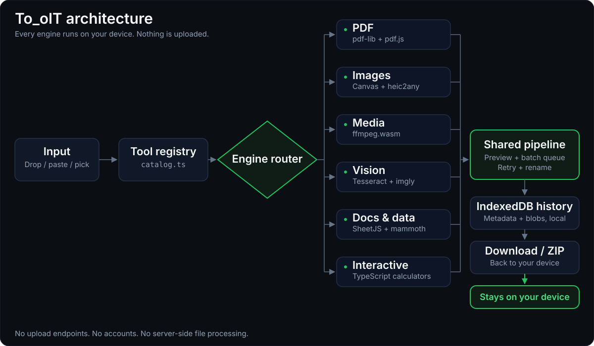

<div align="center">

# To_olT

**Every file tool. One page. Zero uploads.**

175 tools for PDFs, images, video, audio, documents, data, code and design, all running inside your browser.

<p>
  <a href="https://toolt.sdxrnx.workers.dev"></a>
  
  
  
  
</p>

<p>
  
  
  
  
  
</p>

[Live demo](https://toolt.sdxrnx.workers.dev) · [GitHub](https://github.com/SaddexRnx/toolt) · [Why To_olT](#why-to_olt) · [How it compares](#how-it-compares) · [Tool catalog](#tool-catalog) · [Architecture](#architecture) · [Quick start](#quick-start) · [Deploy](#deploy) · [Report a bug](#report-an-issue)

</div>

---

> Most "free" online file tools are a front-end for someone else's computer.
> You upload a document, wait in a queue, and hope the copy is deleted.
> To_olT does the opposite: **the browser is the computer.**

Drop a PDF, a 4K video, a spreadsheet, a JWT or a whole batch of images. Every byte is processed on your device with WebAssembly and plain JavaScript, then handed straight back to you. Nothing is uploaded anywhere, because there is nowhere to upload it to.

There is no file-processing backend to scale, no queue to wait in, no account to create, and no subscription hiding behind a watermark.

<p align="center">
  
</p>

<br />

| Tools | File converters | Interactive tools | Languages | Uploads | Accounts | Trackers |
| :---: | :---: | :---: | :---: | :---: | :---: | :---: |
| **175** | **135** | **40** | **21** | **0** | **0** | **0** |

## Why To_olT

Three ideas drive the whole project.

**Privacy is an architecture, not a promise.**
A server-based converter can only promise to delete your file. To_olT never receives it. There is no upload endpoint, no storage bucket, and no queue worker to leak. Close the tab and the working copy is gone.

**One toolbox beats twelve tabs.**
The average PDF task touches three sites: one to merge, one to compress, one to convert. To_olT puts PDF, image, media, document, data and developer tools behind a single `Cmd+K` palette, with one design language, one history, and one batch queue.

**Speed should not depend on someone's server.**
Local work starts immediately. There is no upload bar, no round trip, and no cold container. Even the heavy engines (FFmpeg, Tesseract, background removal) are downloaded once, only when you use them, and then reused from the browser cache.

## How it compares

The famous tools are good at what they do. They just solve the problem from the other side of the network.

| | **To_olT** | **iLovePDF** | **Smallpdf** | **TinyWow** | **Convertio** | **Adobe Acrobat online** |
| --- | :---: | :---: | :---: | :---: | :---: | :---: |
| Where files are processed | **On your device** | Their servers | Their servers | Their servers | Their servers | Their servers |
| Your file is uploaded | **Never** | Yes | Yes | Yes | Yes | Yes |
| Account required | **No** | No, but limited | No, but limited | No | No, but limited | Yes for most tools |
| Free-tier task limits | **None** | Daily / task caps | Daily / task caps | Varies | Daily caps | Varies |
| Watermarks on free output | **None** | Some tools | Some tools | Some tools | Some tools | Some tools |
| Works offline | **Yes** | No | No | No | No | No |
| Ads or third-party trackers | **None** | Free tier | Free tier | Ads | Ads | Account wall |
| Source code available | **MIT** | No | No | No | No | No |
| Coverage | **175 tools in one app** | PDF-focused | PDF-focused | Broad | Format-focused | Document-focused |

<sub>This compares the processing model and typical free-tier experience of each service, not every paid plan. Limits and policies change, so check each provider for current terms.</sub>

### What that means in practice

- **A 400 MB video never crosses your network.** FFmpeg runs as WebAssembly inside the tab, guarded by a per-tool size cap and a single-job limiter so the device stays responsive.
- **Your PDF is still yours when the tab closes.** No upload means no server-side copy, no retention window, and no "we delete it after 24 hours" footnote.
- **A plane, a train, or a bad hotel Wi-Fi is not a blocker.** After the first visit the shell is cached by a service worker, and the tools that do not fetch an engine keep working offline.
- **You can inspect the thing.** The full source, the tool registry, the security headers, and the WASM integrity pins are all in this repository.

## Tool catalog

<table>
<tr><td width="180"><b>PDF</b></td><td>
Merge, split, rotate, reverse, N-up, page numbers, watermark, blank-page inserter,
extract text, PDF to images, images to PDF, PDF to Word (DOCX), PDF to PPTX / CBZ,
grayscale, metadata strip, page ranges
</td></tr>
<tr><td><b>Images</b></td><td>
PNG, JPG, WEBP, AVIF, BMP, TIFF, GIF, HEIC, ICO, SVG,
convert, compress, resize, crop, rotate, flip, grayscale, invert, blur, watermark,
EXIF strip / viewer, favicon pack, image to/from Base64, SVG to PNG, image to PDF, color pick
</td></tr>
<tr><td><b>Video & audio</b></td><td>
MP4, WEBM, MOV, MKV, AVI, GIF, MP3, WAV, OGG, FLAC, AAC, M4A,
convert, compress, mute, trim, video to GIF, extract audio
</td></tr>
<tr><td><b>Documents</b></td><td>
DOCX, TXT, Markdown, HTML, EPUB, SRT, VTT, ASS,
convert, merge, extract text, ebook extraction, subtitle conversion, Markdown to/from HTML
</td></tr>
<tr><td><b>Spreadsheets & data</b></td><td>
XLSX, CSV, TSV, JSON, JSONL, YAML, TOML, XML,
convert, merge CSVs, split workbooks, deduplicate, format / minify, JSON Schema, JSON to TypeScript
</td></tr>
<tr><td><b>Archives</b></td><td>
ZIP, CBZ, SVGZ, EPUB, HEXE, create / extract / repack, flat or per-folder ZIP export
</td></tr>
<tr><td><b>Encoders & hashes</b></td><td>
Base64, Hex, URL, HTML entities, JWT decode, MD5 / SHA-1 / SHA-256 / SHA-384 / SHA-512,
UUID validation, UUID v4 / v7, NanoID, QR generate / read, barcodes
</td></tr>
<tr><td><b>Text & code</b></td><td>
Case converter, Morse, ROT13, word count, lorem ipsum, slugify, diff, regex tester,
Markdown to HTML, HTML / CSS / SVG minify, SQL formatter
</td></tr>
<tr><td><b>Developer</b></td><td>
JSON diff, JSON to interface, YAML to/from JSON to/from TOML, cron explainer, secrets scanner,
password strength, Kubernetes / Git helpers, cURL to fetch / axios / Python
</td></tr>
<tr><td><b>Interactive</b></td><td>
BMI, calories, mortgage, VAT, unit converters, statistics, fuel cost,
color converter, palette generator, contrast checker, gradient, box-shadow,
button, flexbox, grid, border-radius, typography builders
</td></tr>
<tr><td><b>On-device vision</b></td><td>
OCR (Tesseract), background removal, high-quality canvas upscaling
</td></tr>
</table>

Every tool has a real URL (`/tools/<id>`), its own title, description, canonical link, related tools, and a place in the search palette and sitemap.

## Highlights

- **175 tools, 12 categories.** 135 file converters plus 40 interactive calculators and builders.
- **Smart Drop.** Drop any file and To_olT detects its type, then lists every tool that can open it.
- **Command palette.** `Cmd+K` / `Ctrl+K` searches the entire catalog from anywhere.
- **Batch mode.** Queue dozens of files, preview results, retry failures, rename outputs, and export a ZIP.
- **Local history.** Metadata in `localStorage`, blobs in IndexedDB. Re-download or re-run a past job.
- **21 languages**, including Arabic and Hebrew with proper RTL layout.
- **Light and dark** theme with a solid, high-contrast palette. No gradient soup, no flash on load.
- **Offline shell.** A versioned service worker caches the app shell and hashed assets after the first visit.
- **Deep links and SEO.** Per-tool metadata, Open Graph, JSON-LD, sitemap, and `robots.txt`.
- **Zero telemetry.** No analytics, no accounts, no tracking pixels, no third-party scripts.

## Architecture

The entire app is a static front-end plus a thin SSR shell. Heavy work is isolated behind dynamic imports, so the initial page never pays for an engine it does not use.

<p align="center">
  
</p>

### Stack

| Layer | Built with |
| --- | --- |
| UI | React 19, TanStack Start & Router, Tailwind CSS v4, shadcn/ui primitives |
| Build | Vite 8 (Rolldown), Nitro, Cloudflare Workers |
| PDF | pdf-lib, pdf.js (legacy build for older browsers) |
| Office & data | SheetJS, docx, mammoth, Papa Parse, js-yaml, smol-toml |
| Media | ffmpeg.wasm |
| Vision | tesseract.js, @imgly/background-removal |
| Storage | localStorage (metadata), IndexedDB (blobs) |
| Quality | TypeScript strict mode, ESLint, Prettier |

No API keys. No paid services. No database. No server-side file processing.

## Performance by default

Heavy engines are downloaded on first use and cached by the browser. They are never part of the initial payload.

| Engine | Approx. size | Loaded when |
| --- | ---: | --- |
| `ffmpeg.wasm` core | ~30 MB | first video/audio conversion |
| Tesseract + language data | ~15 MB | first OCR run |
| Background removal model | ~40 MB | first background-removal run |
| pdf.js worker | ~1 MB | first PDF preview or split |
| pdf-lib, docx, SheetJS | small | per tool, on demand |

The initial page ships the shell, the typed tool registry, and Tailwind. Everything else waits for a real job.

## Security & privacy

To_olT has no file-processing backend, no database, no accounts, and no telemetry. The attack surface is intentionally small. The client is still hardened where it matters:

- **Strict response headers.** A Content Security Policy (`default-src 'self'`, `object-src 'none'`, `frame-ancestors 'none'`), `X-Content-Type-Options: nosniff`, `Referrer-Policy`, and a restrictive `Permissions-Policy` on every response.
- **Pinned WASM integrity.** The FFmpeg core fetched from unpkg is verified against a SHA-384 digest before it reaches the loader, so a compromised CDN cannot inject code.
- **Abuse guards.** Per-tool file-size caps, a 250 ms conversion cooldown, and a concurrency limiter for the memory-hungry engines.
- **No code execution paths.** No `eval`, no dynamic `Function()`, no user content passed to `dangerouslySetInnerHTML`.
- **Local-only storage.** History metadata stays in `localStorage`. Result blobs stay in IndexedDB on your device.

The only outbound requests are the optional engine downloads listed above. Everything else is served from the same origin.

## Quick start

```bash
git clone https://github.com/SaddexRnx/toolt.git
cd toolt
bun install
bun run dev
```

Open <http://localhost:8080>.

| Script | What it does |
| --- | --- |
| `bun run dev` | Vite dev server with HMR |
| `bun run build` | Production Cloudflare Worker in `.output/` |
| `bun run preview` | Serve the production build with Wrangler |
| `bun run typecheck` | TypeScript, no emit |
| `bun run lint` | ESLint |
| `bun run format` | Prettier |

> `npm` and `pnpm` work too. The lockfile just happens to be Bun's.

## Deploy

The app is live at **<https://toolt.sdxrnx.workers.dev>**, served by the `toolt` Worker on Cloudflare.

Production builds target that origin for canonical links, Open Graph tags, JSON-LD, and the sitemap. To move to a custom domain, set `VITE_SITE_URL` in the build environment and attach the domain to the Worker.

```bash
bun run build
bunx wrangler deploy
```

Preview the production build locally:

```bash
bun run preview   # wrangler dev
```

## Project structure

```text
src/
├── routes/                    # TanStack Start file-based routes
│   ├── __root.tsx             # HTML shell, no-flash theme, service worker
│   ├── index.tsx              # Catalog home
│   ├── tools.$id.tsx          # One page per tool: /tools/<id>
│   ├── pdf-to-word.tsx        # SEO landing page
│   ├── robots[.]txt.ts        # /robots.txt
│   └── sitemap[.]xml.ts       # /sitemap.xml
├── components/
│   ├── SmartDropZone.tsx      # Detect file type, suggest tools
│   ├── ConverterDialog.tsx    # Batch queue, preview, retry, ZIP, history
│   ├── CalculatorDialog.tsx   # Interactive tools
│   ├── CommandPalette.tsx     # Cmd+K search across all 175 tools
│   └── TopBarControls.tsx     # Language and theme
├── lib/
│   ├── converters.ts          # 135 file families
│   ├── calculators.ts         # 40 interactive tools
│   ├── catalog.ts             # Single source for routes, palette, sitemap
│   ├── site.ts                # Canonical origin (VITE_SITE_URL)
│   ├── ffmpeg.ts              # Lazy FFmpeg loader + SHA-384 pin
│   ├── limits.ts              # Cooldown, concurrency, file-size guards
│   ├── preview.ts             # Thumbnails
│   ├── history.ts             # localStorage + IndexedDB
│   ├── i18n.tsx               # 21 languages
│   └── theme.tsx              # Light / dark
├── styles.css                 # Tailwind v4 tokens and utilities
└── server.ts                  # SSR wrapper + security headers
public/
├── sw.js                      # Offline shell
├── manifest.webmanifest
└── icons, favicon, og image
```

## Engineering notes

A few decisions worth calling out:

- **One registry, every surface.** `src/lib/catalog.ts` derives the homepage cards, per-tool routes, search index, related tools, and sitemap from the same typed data. A tool cannot exist in one place and be missing from another.
- **The registry is data, not markup.** A converter declares its id, category, accepted extensions, output formats, and a `run` function. The queue, preview, download, and history layers are shared by all 135 families.
- **Legacy-safe PDF rendering.** pdf.js v6 calls `Uint8Array.prototype.toHex()`, which older browsers lack. A single loader (`src/lib/pdfjs.ts`) uses the legacy build with the polyfill, so the PDF tools work on Chrome 130 and below, Safari before 18.2, and Firefox before 133.
- **Memory has a budget.** Large jobs are gated by per-tool size caps, a single heavy-engine slot, and a diff matrix cap. A stuck key or a 500 MB file cannot quietly take the tab down.
- **The theme is applied before React.** A tiny inline script reads the saved preference and sets the `dark` class and `dir` attribute before hydration, eliminating the light flash on first paint.
- **Offline is deliberate.** Documents are network-first with a cached shell. Hashed assets are cache-first. The cache is versioned so a new deploy does not serve stale JavaScript.

## Roadmap

- Workflow chaining: feed the output of one tool directly into the next.
- More document editing: redaction and form filling.
- A Playwright regression suite with real PDF, image, audio, and spreadsheet fixtures.
- More accessibility and layout testing across breakpoints.
- Optional encrypted sync for history (off by default, never required).

## Report an issue

Found a bug? A tool that does not work as expected? A typo in the docs? Please let me know.

The easiest way is to [open an issue on GitHub](https://github.com/SaddexRnx/toolt/issues/new). Try to include:

- What you were trying to do (which tool, which file).
- What happened instead (error message, wrong output, blank page).
- Your browser and operating system.
- Steps to reproduce, if you can.

Even a short "this tool gave me a broken PDF" is helpful. Screenshots or the input file (if it is not private) make it much easier to track down.

If you prefer, you can also start a [discussion](https://github.com/SaddexRnx/toolt/discussions) for feature requests or general questions.

## Contributing

Pull requests are welcome. For anything large, open an issue first so the approach can be discussed before the code lands.

Please keep the project true to its identity:

- 100% client-side. No server-side dependencies, no uploads, no hidden APIs.
- Minimal, monochrome design with the single green accent.
- Real tools with real tests, not placeholder cards.
- Accessible markup and keyboard paths for every interactive control.

```bash
bun install
bun run typecheck
bun run build
```

## Credits

Built by [Saddek Renane](https://github.com/SaddexRnx) with a deep respect for the open-source projects that make it possible: pdf-lib, pdf.js, SheetJS, FFmpeg, Tesseract, imgly, TanStack, Vite, Tailwind CSS, and shadcn/ui.

## License

[MIT](LICENSE) © 2026 Saddek Renane

---

<div align="center">
<sub><b>No uploads. No accounts. No server queue.</b></sub>
</div>
